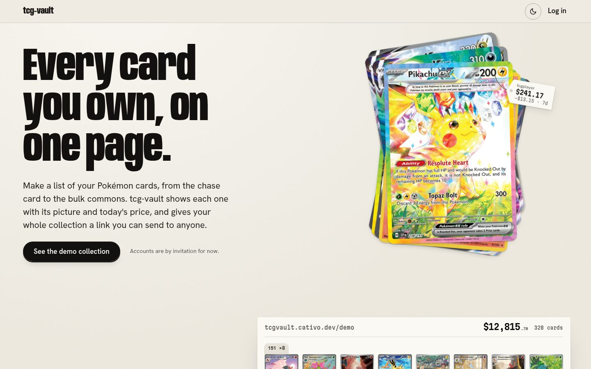
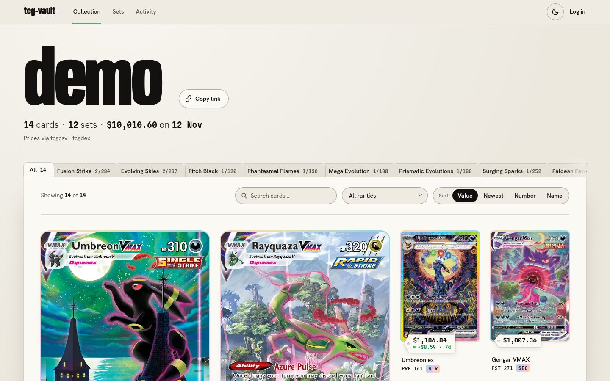

<p align="center">
  <picture>
    <source media="(prefers-color-scheme: dark)" srcset=".github/logo-dark.svg">
    
  </picture>
</p>

<p align="center">
  <a href="https://tcgvault.cativo.dev"></a>
  <a href="LICENSE"></a>
  
  
  
</p>

A personal Pokémon TCG collection tracker. A collector adds the cards they
own (one by one, a whole set at a time, or from a TCGplayer export) and gets
a public page with every card, its daily market price, set completion and
the collection's value over time. The catalog comes from
[tcgdex](https://tcgdex.dev/).

**Live at [tcgvault.cativo.dev](https://tcgvault.cativo.dev)** — see the
[demo collection](https://tcgvault.cativo.dev/demo).

<p align="center">
  
</p>

<p align="center">
  
</p>

## Features

- **Daily market prices, per print.** TCGplayer (USD) from tcgdex and
  [tcgcsv](https://tcgcsv.com/), with Cardmarket (EUR) as the fallback; each
  price says where it came from, and a card's chart covers up to a year.
- **A public page per collector** at `/{username}`: the collection, set
  completion, each card's page and an activity history with the value chart.
- **Special prints** — reverse patterns, cosmos holos, stamped promos and
  Prize Pack prints are their own variants, priced on their own.
- **Fast entry** — tap through a set's grid with undo, add a whole set, or
  import a TCGplayer export; export everything back as CSV.
- **Your own photo** of a copy is shown first; official art is the fallback.
- **A rarity accent** (standard, silver, chase) so the grid reads at a glance
  without knowing the abbreviations.

## Stack

Laravel 13 + Livewire 4 on PHP 8.4, Postgres 17, Redis and Horizon for the
queue. No frontend framework: Tailwind 4, a hand-rolled CSS design system
([`design.md`](design.md)) and small vanilla JS modules.

## Getting started

```bash
./vendor/bin/sail up -d
./vendor/bin/sail artisan migrate
./vendor/bin/sail npm install && ./vendor/bin/sail npm run build
```

Runs on whatever `APP_PORT` is set to in `.env` (`docker-compose.yml`
defaults to 80).

## Try it

Import an entire set (cards + current pricing) from tcgdex:

```bash
./vendor/bin/sail artisan catalog:import-set me05
```

Or sync pricing for every card already in the catalog (the same command
the daily schedule runs):

```bash
./vendor/bin/sail artisan catalog:refresh-prices
```

A re-run skips cards whose sync is still pending; see
[Manual price refresh](deploy/README.md#manual-price-refresh). A single card
failing (not found, a network error, a malformed response) is reported and
skipped — it never aborts the rest of an import or refresh.

## Tests

```bash
./vendor/bin/sail artisan test
./vendor/bin/sail npm run test:js
```

TDD-first (red → green → refactor) on every change in this repo.

## Where to look next

- [`ROADMAP.md`](ROADMAP.md) — what is left to do, quickest valuable work first.
- [`CHANGELOG.md`](CHANGELOG.md) — what shipped in each release.
- [`design.md`](design.md) — the design system: tokens, rules, what is locked.
- [`deploy/README.md`](deploy/README.md) — how releases deploy to production
  through GitHub Actions, and every manual production procedure.
- [`AGENTS.md`](AGENTS.md) — notes for coding agents.

## License

[MIT](LICENSE) © Carlos Cativo
